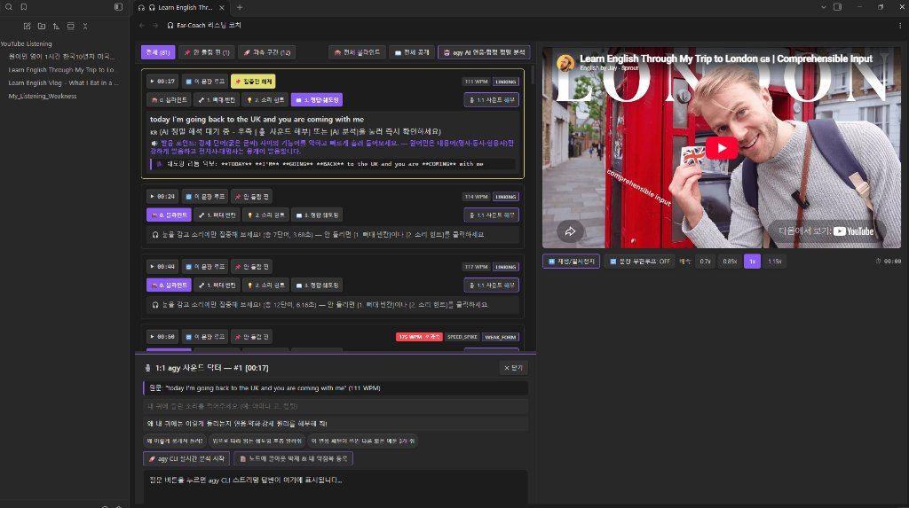

# 🎧 Obsidian Ear-Coach (유튜브 영어 리스닝 & 3단계 블라인드 귀 뚫기 코치)

> **"눈으로 보면 다 아는 쉬운 문장인데, 원어민이 말하면 왜 하나도 안 들릴까?"**  
> **Obsidian Ear-Coach**는 유튜브 영상을 보며 안 들리는 원인을 과학적인 음운 현상(연음, 플랩T, 기능어 약화, 자음 탈락 등)으로 해부하고, **3단계 블라인드 언락(Blind Unlock)**과 **무한 구간 반복**을 통해 당신의 영어 귀를 뚫어주는 **옵시디언 전용 인터랙티브 리스닝 트레이닝 플러그인**입니다.

<div align="center">



*유튜브 영상 동기화 플레이어, 3단계 블라인드 언락 카드, WPM/연음 함정 뱃지 및 1:1 사운드 닥터 드로어가 통합된 전용 워크스페이스*

</div>

---

## ✨ 핵심 기능 한눈에 보기

### 1. ⚡ Zero-Friction 유튜브 가져오기 (원클릭 북마클릿 / 클립보드 / URL)
- **원클릭 브라우저 북마클릿**: 유튜브를 시청하다가 안 들리는 순간, 브라우저 북마크를 클릭하면 **그 재생 시점(초)에 📌 집중 분석 핀**이 찍힌 채로 옵시디언이 자동 실행됩니다.
- **초고속 자막 추출**: 별도 외부 프로그램(yt-dlp 등) 설치 없이도 옵시디언 내장 네트워크를 통해 유튜브 영문 자막을 1초 만에 파싱합니다.

### 2. 🙈 3단계 블라인드 귀 뚫기 트레이너 (3-Step Ear Unlocker)
- **Step 0. 🙈 블라인드**: 자막을 완전히 가리고 소리에만 온전히 집중하여 듣기 훈련
- **Step 1. 🦴 뼈대·빈칸**: 문장의 중심 내용어(명사·동사)만 남기고, 연음/약화로 뭉개진 핵심 단어 1~2개를 타이핑해보는 마이크로 받아쓰기(Micro-Dictation)
- **Step 2. 💡 소리 힌트**: 원어민의 실제 발음(예: `going to -> [거너 / 아머너]`, `did you -> [디쥬]`, `bought a -> [바러]`)과 소리가 변한 이유를 한국어로 명쾌하게 설명
- **Step 3. 📖 정답·쉐도잉**: 전체 원문 자막 공개, 자연스러운 한국어 번역 및 원어민의 강세 호흡을 따라 할 수 있는 쉐도잉 리듬 악보 제공

### 3. 🔁 60fps 실시간 싱크 & A-B 무한 구간 반복 플레이어
- 영상 재생 시 현재 흘러나오는 문장 카드가 $O(\log N)$ 초고속 이진 탐색 엔진을 통해 1ms의 딜레이 없이 실시간 하이라이트됩니다.
- 원하는 문장 카드의 `🔁 이 문장 루프` 버튼을 누르면 해당 문장만 귀가 트일 때까지 무한 반복 재생됩니다.
- 0.7x, 0.85x, 1.0x, 1.15x 미세 배속 조절 지원으로 빠른 발화도 단계별로 훈련할 수 있습니다.

### 4. 🚀 내장 룰베이스 음운 엔진 & 과속 발화(WPM) 감지
- 외부 AI 연결이 없어도 내장된 음성학 규칙 엔진이 플랩T(FLAP_T), 연음(LINKING), 기능어 약화(WEAK_FORM), 자음 탈락(ELISION) 현상을 자동 분석하여 태깅합니다.
- 원어민의 발화 속도(WPM, 분당 단어 수)를 실시간 계산하여 빠른 구간은 `175 WPM 🚀과속` 뱃지로 주의를 환기합니다.

### 5. 🎙️ (선택 사양) 1:1 `agy` 사운드 닥터 AI 실시간 스트리밍
- Google `agy` CLI 환경이 구성되어 있다면, "내 귀엔 '아마나 고'로 들리는데 왜 이래?"처럼 내가 들은 엉뚱한 소리를 입력하여 실시간 AI 코칭을 받을 수 있습니다.
- 답변을 "노트에 콜아웃 박제" 버튼 하나로 마크다운 노트와 약점 대시보드에 영구 기록할 수 있습니다.

### 6. 📊 나만의 듣기 사각지대 대시보드 (`My_Listening_Weakness.md`)
- 내가 안 들려서 📌 핀을 꽂은 문장들과 자주 놓치는 음운 함정 유형 통계가 자동으로 누적되어, 내가 어떤 연음 패턴에 취약한지 한눈에 파악할 수 있습니다.

### 7. ⚡ 초경량 JSON 사이드카 & Zero-Blur 고성능 아키텍처
- 긴 영상의 방대한 자막 데이터를 압축 JSON 사이드카(`.obsidian/plugins/obsidian-ear-coach/sessions/`)로 분리 저장하여 마크다운 노트 본문은 30줄 내외로 초경량 유지됩니다.
- 수천 개의 문장이 포함된 1시간 이상 영상도 화면에 보이는 카드 15개만 렌더링하는 가상 스크롤(Virtual Scrolling)을 적용하여 60fps의 부드러운 스크롤을 보장합니다.

---

## 📥 설치 및 적용 방법

### 방법 1. 빌드 파일 직접 복사 (가장 간단하고 빠른 방법 ⭐)

1. 최신 빌드 산출물에서 아래 **3개 필수 파일**을 준비합니다:
   - `main.js`
   - `manifest.json`
   - `styles.css`
2. 사용 중인 옵시디언 볼트(Vault) 폴더 아래 다음 경로로 새 폴더를 생성합니다:
   ```text
   <내 옵시디언 볼트 폴더>/.obsidian/plugins/obsidian-ear-coach/
   ```
   *(※ `.obsidian` 폴더는 숨김 폴더이므로 파일 탐색기에서 '숨김 항목 표시'를 켜주세요)*
3. 위에서 준비한 3개 파일을 해당 폴더 안에 복사하여 넣습니다.
4. 옵시디언을 실행한 후 좌측 하단 **설정(톱니바퀴 아이콘)** ➔ **커뮤니티 플러그인(Community plugins)**으로 이동합니다.
5. "제한 모드(Restricted mode)"를 끄고, 설치된 플러그인 목록 우측의 **새로고침(🔄)** 아이콘을 누릅니다.
6. 목록에 나타난 **"Ear-Coach (YouTube Listening Coach)"**의 토글 스위치를 켜서 **활성화**합니다!

---

### 방법 2. 소스코드에서 직접 빌드하기 (개발자용)

Node.js(v18 이상 권장)가 설치된 환경에서 직접 빌드하여 적용할 수 있습니다:

```bash
# 1. 저장소 클론
git clone https://github.com/your-username/obsidian-ear-coach.git
cd obsidian-ear-coach

# 2. 의존성 패키지 설치
npm install

# 3. esbuild 고속 번들링 (main.js 생성)
npm run build
```

빌드 완료 후 루트 디렉토리에 생성된 `main.js`, `manifest.json`, `styles.css` 파일을 옵시디언 볼트의 `.obsidian/plugins/obsidian-ear-coach/` 경로에 넣어주시면 됩니다.

---

## 🚀 빠른 시작 가이드 (어떻게 쓰나요?)


### 1단계: 브라우저 원클릭 북마클릿 등록 (강력 추천!)
1. 옵시디언 좌측 하단 설정 ➔ **🎧 Ear-Coach 설정**으로 이동합니다.
2. 최상단 **"📋 북마클릿 복사"** 버튼을 클릭합니다.
3. 크롬/웨일/엣지 등 웹 브라우저의 북마크바에서 마우스 우클릭 ➔ **"페이지 추가(새 북마크)"**를 누릅니다.
4. 이름은 `🎧 Ear-Coach`, URL(주소)란에 복사한 코드를 그대로 붙여넣고 저장합니다.
5. 이제 유튜브를 시청하다가 영어가 안 들리는 순간 북마클릿을 누르면, **그 시점(초)에 📌 핀이 찍힌 채로 옵시디언이 즉시 열립니다!**

### 2단계: 리스닝 노트 생성 및 워크스페이스 열기
* **클립보드 단축키**: 유튜브 URL을 복사한 상태에서 `Ctrl + P` (Mac: `Cmd + P`) ➔ `Ear-Coach: 클립보드 유튜브 URL로 즉시 리스닝 노트 생성` 실행
* **리본 아이콘**: 옵시디언 좌측 툴바의 헤드폰(🎧) 아이콘을 클릭하여 유튜브 URL 입력
* 자막 파싱이 끝나면 0.02초 만에 좌측 자막 리스트와 우측 유튜브 플레이어가 결합된 전용 워크스페이스가 열립니다.

### 3단계: 귀 틔우기 실전 트레이닝
1. **소리 먼저 듣기**: `🙈 0. 블라인드` 상태로 두고 문장의 `▶ 재생` 또는 `🔁 이 문장 루프`를 눌러 2~3회 소리만 집중해서 듣습니다.
2. **빈칸 맞춰보기**: `🦴 1. 뼈대·빈칸`을 눌러 안 들린 단어를 타이핑해 보고 내 귀의 오답을 확인합니다.
3. **소리 원리 이해하기**: `💡 2. 소리 힌트`를 눌러 원어민이 왜 소리를 흘렸는지([바러], [디쥬], [워너] 등) 해설을 읽습니다.
4. **쉐도잉으로 굳히기**: `📖 3. 정답·쉐도잉`을 누르고 대문자로 표시된 강세 리듬 악보를 보며 원어민의 호흡과 속도에 맞춰 따라 말합니다.
5. **복습 관리**: 확실히 들리지 않는 문장은 `📌 안 들림 핀`을 꽂아두고 상단 툴바의 `📌 안 들림 핀` 필터로 모아서 반복 청취합니다.

---

## ❓ FAQ (자주 묻는 질문)

**Q. `agy` CLI가 설치되지 않은 일반 PC에서도 사용할 수 있나요?**  
**A.** 네, 아무런 문제 없이 100% 사용하실 수 있습니다! 유튜브 자막 추출, 문장 단위 병합, A-B 무한 구간 반복, 3단계 블라인드 훈련, 내장 룰베이스 음운 엔진(Flap T, 연음 등 감지), WPM 과속 측정, 약점 대시보드 누적 등 **핵심 기능은 모두 옵시디언 내부 엔진으로 독립 동작**합니다. `agy`는 실시간 1:1 사운드 닥터 대화 및 AI 정밀 번역을 위한 선택 사양입니다.

**Q. 1시간이 넘는 긴 유튜브 영상도 노트를 만들 수 있나요?**  
**A.** 네, 완벽히 지원합니다. 대용량 세션 데이터는 별도 압축 JSON 파일로 관리되어 마크다운 파일 크기를 수십 줄로 가볍게 유지하며, 가상 스크롤(Virtual Scrolling)을 통해 수천 문장이 있어도 메모리와 CPU 점유율을 최소화하여 60fps로 부드럽게 작동합니다.

**Q. 자막이 없는 영상도 가능한가요?**  
**A.** 유튜브 자동 생성 자막(Auto-generated / ASR) 또는 공식 업로드 영문 자막이 제공되는 모든 영상에서 지원됩니다.

---

## 🛠️ 기술 스택 및 성능 아키텍처

- **Framework**: Obsidian Plugin API (TypeScript)
- **Player Engine**: YouTube IFrame API (초고속 재활용 파이프라인)
- **Sync Algorithm**: $O(\log N)$ Forward-Biased Binary Search with Hit-Cache
- **Virtual Scrolling**: Dynamic-Height Virtual Segment Engine (화면당 15개 DOM 유지)
- **Background Worker**: Web Worker Inline Bundling (자막 병합 및 JSON 비동기 파싱)
- **Design Principle**: Zero-Blur CSS (GPU 렌더링 병목 제로화)

---

## 📄 라이선스 (License)

This project is licensed under the MIT License.
