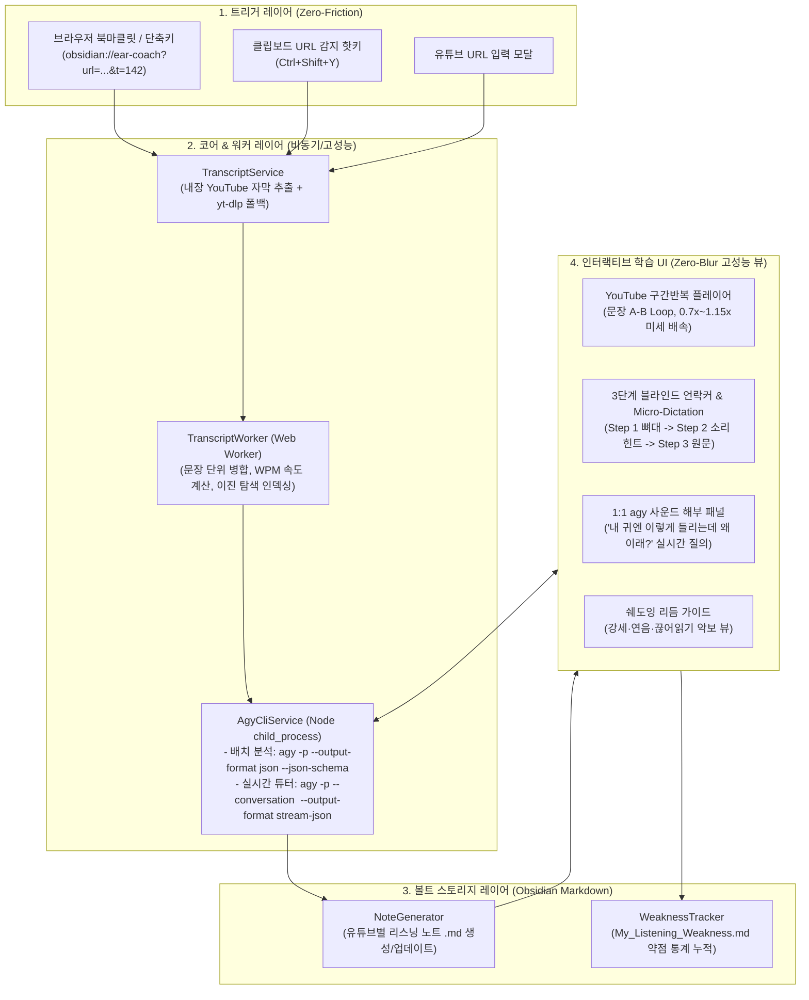

# 🎧 Obsidian Ear-Coach (YouTube + Obsidian + `agy` CLI) 상세 개발 계획서

> [!IMPORTANT]
> 본 계획서는 **옵션 A (Obsidian 올인원 플러그인)** 기반의 상세 설계서입니다.  
> 형님께서 계획서를 검토하신 후 **Proceed** 버튼을 눌러주시면 그때부터 Phase 1 코딩을 시작합니다.

---

## 1. 프로젝트 목표 및 설계 원칙

### 1.1 핵심 목표
단순히 유튜브 자막을 번역해 주는 독해용 노트가 아니라, **유튜브 URL 트리거 한 번으로 안 들리는 원어민의 소리 변화(연음·약화·탈락·과속)를 분석**하고, Obsidian 내부에서 **문장 단위 무한 구간 반복 + 3단계 블라인드 힌트 + `agy` CLI 실시간 1:1 사운드 코칭**을 제공하는 **귀 틔우기 전용 워크스페이스**를 구축합니다.

### 1.2 성능 및 아키텍처 핵심 규칙 (엄격 준수)
1. **소규모 단일 책임 파일 분리 (900줄 제한 엄수)**:
   - 모든 UI 컴포넌트, 비즈니스 로직, 파서, CLI 브릿지를 작은 단위 파일(파일당 100~350줄 내외)로 분리하여 유지보수성과 가독성을 극대화합니다.
2. **고성능 UI & Zero-Blur 원칙**:
   - 렌더링 성능을 갉아먹는 `backdrop-filter: blur()`, 과도한 `box-shadow` 애니메이션 등을 전면 배제하고 깔끔한 솔리드/보더 중심의 고대비 테마 변수(Obsidian CSS Variables)를 사용합니다.
3. **대용량 자막 처리를 위한 Web Worker & 메모이제이션**:
   - 1시간짜리 긴 유튜브 영상(수천 개 자막 세그먼트)도 UI 버벅임 없이 처리하기 위해 **자막 병합·WPM(분당 단어 수) 계산·정규식 전처리는 Web Worker**에서 수행합니다.
   - 영상 재생 중 현재 타임스탬프에 맞는 문장을 찾는 로직은 선형 탐색($O(N)$) 대신 **이진 탐색(Binary Search, $O(\log N)$) + 메모이제이션 캐시**를 적용하여 재생 부하를 최소화합니다.
4. **`important/APP_MAP.md` 아키텍처 지도 상시 동기화**:
   - 프로젝트 루트의 `important/APP_MAP.md`에 모든 모듈, 파일 역할, 인터페이스를 정의하고 파일이 추가·변경될 때마다 즉시 업데이트합니다.

---

## 2. 전체 시스템 아키텍처



---

## 3. 핵심 기능 상세 설계

### 3.1 [트리거] 귀찮음 제로! 3가지 유입 경로
1. **`obsidian://ear-coach` Custom URI 핸들러**:
   - 파라미터: `url` (유튜브 주소), `t` (선택: 현재 재생 초), `pin=true` (선택: 안 들리는 구간 핀 마킹 여부)
   - 유튜브 시청 중 북마클릿 클릭 한 번으로 Obsidian이 열리며 노트가 생성됩니다. 이미 해당 영상의 노트가 존재하면 노트를 새로 덮어쓰지 않고 **해당 타임스탬프(`t`) 문장에 `📌 집중 분석 핀`만 즉시 추가**하고 그 문장으로 포커스를 이동합니다.
   - **원클릭 북마클릿 복사 기능**: 플러그인 설정 탭에서 버튼 하나로 크롬 북마크바에 등록할 수 있는 자바스크립트 북마클릿 코드를 클립보드에 복사해 줍니다.
2. **클립보드 URL 자동 감지 핫키**:
   - 명령어 팔레트(`Ear-Coach: 클립보드 유튜브 URL로 리스닝 노트 생성`) 실행 시 클립보드의 유튜브 링크(일반 영상, Shorts, `youtu.be` 단축 URL, 타임스탬프 포함 URL 모두 지원)를 즉시 파싱합니다.

### 3.2 [자동 분석] Web Worker + `agy` CLI 배치 레이더
1. **고속 자막 추출 및 문장 재조립 (Web Worker)**:
   - 유튜브 자동 자막은 단어/구절 단위로 잘게 쪼개져 있어 학습에 불편합니다.
   - `TranscriptWorker`가 자막 조각들을 자연스러운 문장 단위로 병합하고, 문장별 소요 시간 대비 단어 수로 **WPM(Words Per Minute)**을 계산해 기준치(예: 180 WPM) 이상인 문장에 `🚀 과속 구간` 배지를 자동 부착합니다.
2. **`agy` CLI 구조화 사운드 함정 진단 (`agy -p --json-schema`)**:
   - 추출된 대본(특히 유저가 핀을 꽂은 구간 및 핵심 문장들)을 `agy` CLI에 JSON Schema와 함께 전달하여 다음 데이터를 자동으로 받아옵니다:
     - `traps`: 한국인이 못 듣는 원인 분류 (`LINKING` 연음, `FLAP_T` 플랩 현상, `WEAK_FORM` 기능어 약화, `ELISION` 자음 탈락, `SLANG` 구어체/숙어)
     - `phoneticKr`: 실제 원어민 소리에 가장 가까운 한글/발음 힌트 (예: `"did you eat"` $\rightarrow$ `"[쥣 / 디쥬잇]"`)
     - `skeletonWords`: 1단계 힌트에서 보여줄 강세 핵심어 인덱스 목록
     - `dictationBlanks`: Micro-Dictation에서 빈칸으로 뚫어놓을 핵심 연음 구간 단어 인덱스
     - `rhythmGuide`: 쉐도잉용 강세 및 끊어읽기 표기 (예: `"I **BOUGHT** a **CAR** / **YES**terday"`)
     - `translationKr`: 자연스러운 한국어 의미

### 3.3 [인터랙티브 UI] 귀를 뚫어주는 4대 트레이닝 모듈
Obsidian 우측(또는 메인) 워크스페이스 탭에 열리는 전용 `EarCoachView`와 마크다운 노트 내 코드블록 프로세서를 함께 지원합니다.

1. **YouTube A-B 문장 무한 루프 플레이어**:
   - 문장 카드를 클릭하면 해당 문장의 `startTime` ~ `endTime` 구간만 계속 반복 재생(`Loop Mode`)합니다. (앞뒤 여유 패딩 `+0.3초` 설정 가능)
   - 키보드 단축키 지원: `Space`(재생/일시정지), `R`(현재 문장 다시 듣기), `L`(현재 문장 무한 루프 토글), `[` / `]`(배속 0.05x 단위 조절).
2. **3단계 귀 틔우기 언락커 (3-Step Ear Unlocker)**:
   - **기본 상태 (Blind)**: 자막 텍스트가 가려져 있고 `[WPM 195 🚀] [🔗 연음 주의]` 배지만 보입니다. 오직 귀로만 먼저 듣습니다.
   - **Step 1 (뼈대 + Micro-Dictation)**: 강세가 있는 명사/동사만 보이고, 뭉개진 연음 구간은 `[ ______ ]` 입력창으로 열립니다. 유저가 직접 타이핑해서 맞춰보거나(Micro-Dictation), **"내가 들은 소리(예: 바러)"**를 메모할 수 있습니다.
   - **Step 2 (소리 힌트)**: 정답 스펠링 대신 **실제 발음 힌트(`💡 소리: [바러] - Flap T 연음`)**만 먼저 보여줍니다. 이 힌트를 보고 다시 들으면 안 들리던 소리가 귀에 꽂힙니다!
   - **Step 3 (전체 공개)**: 원래 영어 문장, 한국어 해석, 왜 그렇게 소리 났는지 음운 현상 해설, 쉐도잉 리듬 악보를 모두 공개합니다.
3. **`agy` CLI 직결! 실시간 1:1 사운드 닥터 (Interactive Coach)**:
   - 문장 카드의 `[🎙️ 왜 이렇게 들려?]` 버튼을 누르고 *"나한테는 '아마나 고'처럼 들리는데 왜 이래?"*라고 질문하면,
   - `agy` CLI가 해당 노트의 고유 `--conversation <id>` 세션을 유지한 채 `stream-json`으로 실시간 답변을 스트리밍합니다.
   - 답변이 완료되면 **[노트에 콜아웃으로 저장]** 및 **[내 약점 사운드북에 등록]** 버튼으로 즉시 기록할 수 있습니다.
4. **내 귀의 사각지대 대시보드 (`My_Listening_Weakness.md`)**:
   - 유저가 `📌 안 들림` 핀을 꽂거나 `agy`에게 질문한 문장들의 함정 유형(`LINKING`, `FLAP_T`, `WEAK_FORM` 등)을 집계하여 볼트 내 `My_Listening_Weakness.md` 노트에 **취약 패턴 TOP 순위, 내가 자주 못 듣는 발음 리스트, 원클릭 복습 링크**를 자동으로 업데이트합니다.

---

## 4. 모듈형 디렉토리 및 파일 구조

한 파일이 너무 많은 역할을 하지 않고 900줄을 절대 넘지 않도록, 아래와 같이 세분화된 구조로 작성합니다.

```text
happynote2/
├── important/
│   └── APP_MAP.md                        # 전체 아키텍처, 파일 역할, 인터페이스 명세서
├── docs/
│   ├── implementation_plan.md            # 본 구현 계획서
│   └── history/                          # 7일 경과 계획서 보관 폴더
├── manifest.json                         # Obsidian 플러그인 매니페스트
├── package.json                          # 의존성 및 빌드 스크립트
├── tsconfig.json                         # TypeScript 설정
├── esbuild.config.mjs                    # 고성능 번들러 설정 (Worker 인라인 번들링 포함)
├── styles.css                            # Zero-Blur 고성능 스타일시트
└── src/
    ├── main.ts                           # 플러그인 진입점 (라이프사이클, 커맨드, URI 등록)
    ├── types/
    │   ├── transcript.ts                 # 자막 세그먼트, WPM, 함정 태그 인터페이스
    │   ├── agy.ts                        # agy CLI 요청/응답, JSON Schema, 스트림 이벤트 타입
    │   └── settings.ts                   # 플러그인 설정 인터페이스 및 기본값
    ├── services/
    │   ├── TranscriptService.ts          # 유튜브 Video ID 파싱 및 자막 추출 (Innertube + yt-dlp 폴백)
    │   ├── AgyCliService.ts              # agy CLI 프로세스 실행, JSON 배치 분석, 실시간 스트리밍 세션 관리
    │   ├── NoteGenerator.ts              # Obsidian 마크다운 노트 생성, 프론트매터 & 핀 업데이트
    │   └── WeaknessTracker.ts            # My_Listening_Weakness.md 약점 통계 집계 및 갱신
    ├── workers/
    │   ├── transcriptProcessor.ts        # 자막 문장 병합, WPM 계산, 이진 탐색 인덱싱 순수 로직
    │   └── transcript.worker.ts          # Web Worker 래퍼 (대용량 자막 비동기 처리)
    ├── utils/
    │   ├── binarySearch.ts               # 타임스탬프 -> 현재 문장 고속 탐색 O(log N) 및 메모이제이션
    │   └── youtubeUrlParser.ts           # 다양한 유튜브 URL 및 타임스탬프(?t=120) 파서 & 북마클릿 생성기
    └── ui/
        ├── EarCoachView.ts               # 메인 리스닝 워크스페이스 ItemView 컨테이너
        ├── UrlInputModal.ts              # 유튜브 URL & 타임스탬프 수동 입력 모달
        ├── SettingsTab.ts                # 플러그인 설정 탭 (agy 경로, 기본 배속, 북마클릿 복사 버튼)
        └── components/
            ├── PlayerBar.ts              # 유튜브 IFrame 플레이어, A-B 구간 루프, 미세 배속 컨트롤러
            ├── SegmentCard.ts            # 개별 문장 카드 (3단계 블라인드 언락커, 쉐도잉 리듬 표시)
            ├── MicroDictationBox.ts      # 핵심 연음 빈칸 타이핑 & '내가 들은 소리' 비교 컴포넌트
            └── AgyTutorPanel.ts          # 문장별 1:1 agy 사운드 해부 스트리밍 채팅 패널
```

---

## 5. 단계별 구현 로드맵 (Implementation Phases)

### Phase 1: 기반 환경 구축 및 `important/APP_MAP.md` 작성
- Obsidian TypeScript 플러그인 빌드 환경(`package.json`, `tsconfig.json`, `esbuild.config.mjs`, `manifest.json`) 구성
- `src/types/` 하위 핵심 데이터 인터페이스(`transcript.ts`, `agy.ts`, `settings.ts`) 정의
- `important/APP_MAP.md` 초기 문서 생성 및 인터페이스 명세화

### Phase 2: 트리거, 유튜브 자막 추출 & 고성능 Web Worker 구현
- `youtubeUrlParser.ts`: 유튜브 URL / Shorts / 타임스탬프 추출 및 브라우저 북마클릿 스니펫 생성기 구현
- `TranscriptService.ts`: 별도 외부 툴 없이도 즉시 동작하는 내장 YouTube 자막 패처 + 로컬 `yt-dlp` 폴백 구현
- `transcriptProcessor.ts` & `transcript.worker.ts` & `binarySearch.ts`: 파편화된 자막을 문장 단위로 병합하고 WPM 계산 및 $O(\log N)$ 타임스탬프 탐색 메모이제이션 구현

### Phase 3: `agy` CLI 브릿지 (`AgyCliService`) 및 마크다운 스토리지 구현
- `AgyCliService.ts`:
  - `analyzeTranscriptBatch()`: `agy -p --output-format json --json-schema`를 호출하여 연음/약화/발음힌트/빈칸/쉐도잉 악보 자동 생성
  - `askSoundDoctorStream()`: `agy -p --conversation <id> --output-format stream-json`을 호출하여 왜 안 들렸는지 실시간 스트리밍 질의응답 및 세션 ID 유지
- `NoteGenerator.ts` & `WeaknessTracker.ts`: 리스닝 노트(`.md`) 생성/업데이트 및 `My_Listening_Weakness.md` 자동 누적 로직 구현

### Phase 4: 인터랙티브 리스닝 워크스페이스 UI 구현 (Zero-Blur)
- `PlayerBar.ts`: YouTube IFrame API 연동, 문장 A-B 무한 루프, 배속 조절 UI
- `SegmentCard.ts` & `MicroDictationBox.ts`: 3단계 블라인드 힌트 언락커, 핵심 연음 빈칸 맞추기, 쉐도잉 리듬 뷰
- `AgyTutorPanel.ts`: 선택한 문장에 대한 실시간 `agy` 질의응답 및 노트에 콜아웃 박제 버튼
- `EarCoachView.ts`, `UrlInputModal.ts`, `SettingsTab.ts`, `main.ts` 통합 및 `styles.css` (Blur 없는 고성능 다크/라이트 테마 대응) 적용

### Phase 5: 빌드 검증, 단위/성능 테스트 및 문서 최종 업데이트
- TypeScript 타입 체크, 번들 빌드 테스트, 대용량 자막 처리 및 이진 탐색 단위 테스트 수행 (`docs/test_result.txt`에 결과 기록)
- `important/APP_MAP.md` 최종 동기화 및 성능 체크리스트 점검
